<p align="center">
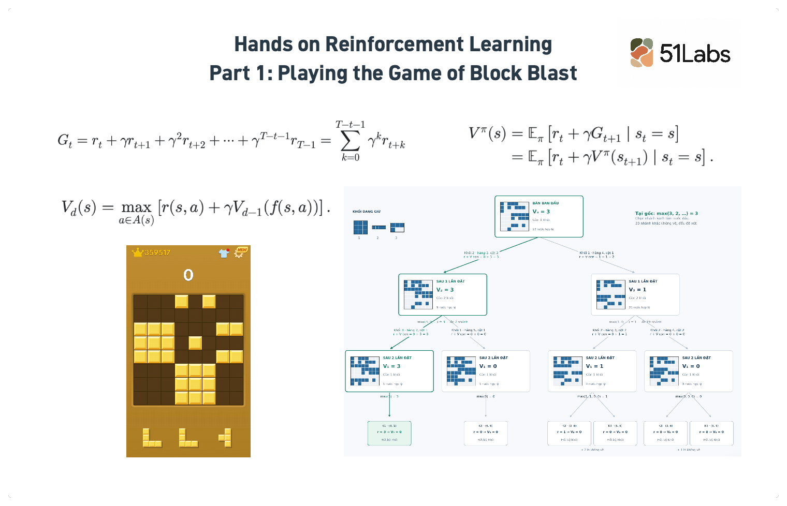
</p>


Chúng ta thường hay được nghe về 1 lời khuyên rất quen thuộc khi phải ra một quyết định gì đó lớn trong cuộc sống là “Viết ra giấy lợi và hại khi làm việc đó đi”. Câu nói tưởng chừng như đơn giản ấy chính là một trong những ý tưởng cốt lõi nhất của cả một ngành học về việc ra quyết định **Reinforcement learning (RL).** Bản thân từ reinforce là một từ rất là thú vị, mang ý nghĩa củng cố hoặc tự thuyết phục lại quan điểm của mình dựa trên kết quả ta tiếp nhận được. Vì vậy, Reinforcement learning theo 51Labs tự định nghĩa là việc tối ưu việc ra quyết định dựa trên việc trích xuất và học hỏi từ các kết quả ta thu nhận được, từ đó tối ưu lại quy trình ước tính, dự đoán để dẫn tới quyết định cuối cùng.

Bản thân RL là một khung lý thuyết lớn và được áp dụng vào trong rất nhiều lĩnh vực khoa học. Với lĩnh vực về tài chính định lượng, khung lý thuyết này nằm trọn trong quá trình đầu tư và trading. Vì vậy, 51Labs cũng bắt đầu chuỗi bài viết về RL nhằm đưa ra một vài thử nghiệm cũng như ứng dụng của 51Labs với RL.

Tuy nhiên, nếu chỉ ứng dụng RL cho đầu tư hay trading thì thật chán, vì vậy, chuỗi bài viết này sẽ bắt đầu tư dễ đến thú vị đến rất khó (và rất vui) để chúng ta có thể hiểu kĩ hơn và ứng dụng được RL vào trong bất cứ ngành nghề nào cần “Quất”.

Bắt đầu với chuỗi bài viết đầu tiên “Introduction to RL: Playing the game of Block Blast”.


## Key concept

### Học từ phản hồi (Feedback)

Nếu đã từng tìm hiểu về Machine Learning, có lẽ chúng ta khá quen thuộc với cách học từ dữ liệu và nhãn trong **Supervised Learning (học có giám sát)**. Ví dụ, để dạy một mô hình nhận diện chó và mèo, ta chuẩn bị những bức ảnh kèm nhãn tương ứng. Mô hình nhìn ảnh, đưa ra dự đoán, rồi so sánh với nhãn để biết mình đang sai ở đâu. Qua nhiều lần điều chỉnh, chúng ta kỳ vọng mô hình có thể nhận diện được cả những bức ảnh chưa từng gặp.

<p align="center">
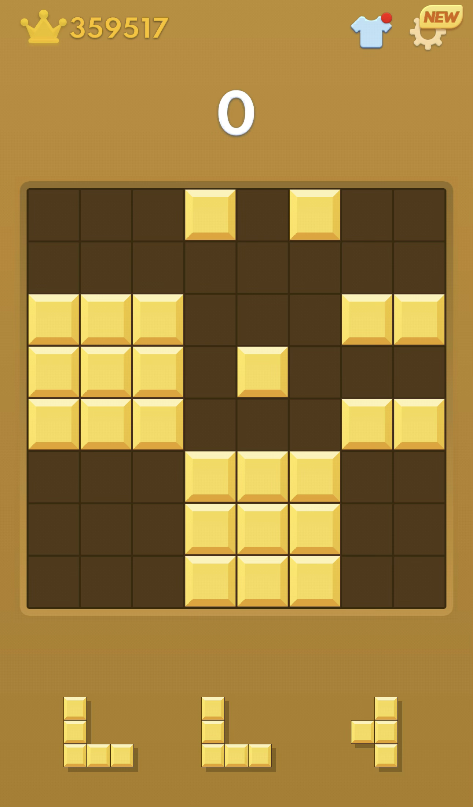
</p>


Tuy nhiên, hãy thử tưởng tượng nếu ta áp dụng cách này vô trò chơi Block Blast nổi tiếng thì sẽ làm sao? Tương đối khó nhỉ :). Đưa cho mô hình một bàn chơi và ba khối đang chờ, chúng ta muốn nó biết “chọn khối nào, đặt vào đâu?”. Bản thân người chuẩn bị dữ liệu cũng chưa chắc biết nước đi tốt nhất. Nếu đã có đáp án cho mọi tình huống thì có lẽ chúng ta cũng chơi rất giỏi rồi. Tuy nhiên, không có đáp án không có nghĩa là không có gì để học. Ta vẫn có thể đặt thử một khối, quan sát bàn chơi thay đổi và xem mình xóa được bao nhiêu hàng hay cột. Đó chính là **feedback**. Trong RL, tín hiệu đánh giá được biểu diễn bằng **reward (phần thưởng)**, giúp các thuật toán RL điều chỉnh cách hành động qua trải nghiệm.

Điều thú vị là có điểm ngay chưa chắc đã là một nước đi tốt. Xóa được một hàng nhưng chiếm mất chỗ đặt khối tiếp theo thì cũng hơi “lợi bất cập hại”. Vì vậy, chúng ta cần nhìn vào **return**, ký hiệu $G_t$, để tính cả phần thưởng hiện tại lẫn những lượt sau. Ta dùng thêm **hệ số chiết khấu** $\gamma$, khá giống cách quy đổi tiền tương lai về hiện tại trong *Time Value of Money*. Giả sử lãi suất ngân hàng là 5% một năm, 100 đồng nhận sau một năm có giá trị hiện tại khoảng 95,24 đồng; nếu phải chờ hai năm thì còn khoảng 90,70 đồng. Phần thưởng trong RL cũng được quy đổi tương tự: nhận sau một lượt thì nhân với $\gamma$, sau hai lượt nhân với $\gamma^2$. Khi $\gamma<1$, phần thưởng càng ở xa càng có trọng số nhỏ hơn trong quyết định hiện tại.

$$
G_t = r_t+\gamma r_{t+1}+\gamma^2r_{t+2}+\cdots+\gamma^{T-t-1}r_{T-1} = \sum_{k=0}^{T-t-1}\gamma^k r_{t+k}
$$

Ở đây, $r_t$ là reward sau hành động tại bước $t$, còn $T$ là thời điểm kết thúc ván. $\gamma$ nằm trong khoảng từ 0 đến 1 và càng gần 1 thì phần thưởng tương lai càng được coi trọng. Khác với ví dụ ngân hàng, trong trò chơi, $\gamma$ là tham số chúng ta lựa chọn. Mục tiêu lúc này là học cách hành động để **tổng phần thưởng chiết khấu kỳ vọng cao hơn**, thay vì chỉ kiếm điểm ngay trước mắt. Hệ số $\gamma$ sẽ cân bằng được tìm kiếm lợi ích ngắn hạn hay ưu tiên lợi ích dài hạn.

Nhưng những phần thưởng tương lai ấy đến từ đâu? Một nước đi làm thay đổi bàn chơi, bàn mới tạo ra những lựa chọn tiếp theo, rồi những lựa chọn đó lại dẫn tới kết quả khác. Muốn đánh giá quyết định hiện tại, chúng ta cần mô tả được mối liên hệ này. **Markov Decision Process (MDP)** cung cấp khung toán học để làm điều đó, thông qua trạng thái, hành động, quy luật chuyển trạng thái và phần thưởng. Đây là cách chúng ta biến việc “thử rồi rút kinh nghiệm” thành một bài toán có thể phân tích và xây dựng thuật toán để giải.

### Markov Decision Process (MDP)

Ở phần trước, chúng ta đã có một cách đánh giá kết quả qua nhiều bước bằng return $G_t$. Bây giờ, cần mô tả rõ **mỗi quyết định sẽ đưa chúng ta đến đâu và nhận được gì**. Để dễ hình dung, hãy tạm chuyển sang một mê cung nhỏ: xuất phát từ S, đi qua các ô trống và tìm đường đến G với ít bước nhất.

<p align="center">
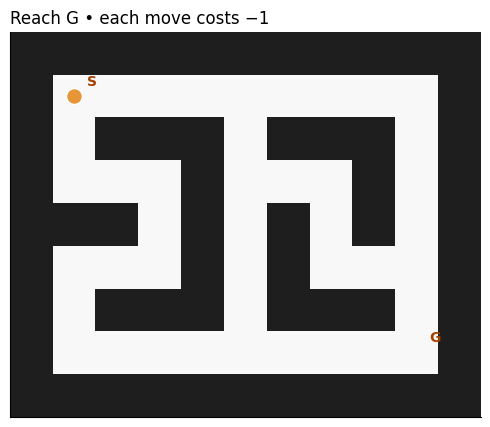
</p>


Trong mê cung, mỗi lượt diễn ra như sau: chúng ta đang đứng tại một ô, chọn một hướng đi, rồi chuyển sang ô tiếp theo. Nếu gặp tường thì đứng yên. Mỗi lần di chuyển đều nhận reward là −1, kể cả khi đâm vào tường, và đến G thì kết thúc. Với $\gamma=1$, đi 10 bước nhận tổng reward −10, tốt hơn đi 20 bước nhận −20. Như vậy, mục tiêu tìm đường ngắn nhất đã được chuyển thành mô hình hoá thành tối đa hóa return, 1 bài toán về tối ưu (optimization)!

Để lựa chọn hướng đi một cách có hệ thống, chúng ta cần một mô hình liên kết vị trí hiện tại, hành động được chọn và kết quả sau đó. **Markov Decision Process (MDP)** cung cấp khung toán học để mô tả những mối liên hệ này, làm cơ sở cho việc so sánh các lựa chọn và tìm cách đi tốt hơn.

**Markov Decision Process (MDP)** giúp mô tả quá trình này bằng bốn thành phần:

| **Thành phần**                     | **Trong mê cung**                                        |
| ---------------------------------- | -------------------------------------------------------- |
| **State — Trạng thái**             | Chúng ta đang đứng ở ô nào?                              |
| **Action — Hành động**             | Chúng ta chọn đi hướng nào?                              |
| **Transition — Chuyển trạng thái** | Hướng đó đưa chúng ta sang ô nào, hay bị tường chặn lại? |
| **Reward — Phần thưởng**           | Chúng ta nhận được bao nhiêu điểm sau bước đó?           |

Gọi vị trí hiện tại là $s_t$, hướng được chọn là $a_t$, ta có thể viết một lượt di chuyển thành:

$$
s_{t+1}=f(s_t,a_t),\qquad r_t=-1
\\
$$

Ở đây, $f$ chỉ đơn giản là luật di chuyển trên bản đồ. Ví dụ, đang ở ô $(2,3)$ và chọn sang phải: nếu ô $(2,4)$ trống thì đi tới đó, còn có tường thì vẫn ở $(2,3)$.

Chữ **Markov** nói đến một điều khá tự nhiên trong ví dụ này: để xác định kết quả của bước đi tiếp theo, chúng ta chỉ cần biết ô đang đứng và hướng định đi. Không cần biết trước đó đã đi đường nào để đến đây. Với bản đồ cố định, vị trí hiện tại đã chứa đủ thông tin cần thiết cho bước chuyển tiếp.

Đến đây, chúng ta đã mô tả được luật chơi. Vậy **làm thế nào để chơi tốt hơn?** Trong RL, cách người chơi lựa chọn hành động ở mỗi trạng thái được gọi là **policy - chính sách**. Với mê cung, đó là cách chúng ta chọn hướng đi tại mỗi ô; cải thiện policy nghĩa là tìm được cách đi đến đích với ít bước hơn, qua đó đạt return cao hơn. Nhưng khi hướng nào cũng nhận ngay −1 điểm, làm sao biết lựa chọn nào tốt hơn? Chúng ta cần nhìn xa hơn một bước: **từ ô tiếp theo, nếu tiếp tục chơi theo policy của mình, ta kỳ vọng nhận được tổng phần thưởng bao nhiêu cho đến khi kết thúc?** Đây chính là câu hỏi mà *value function* giúp chúng ta trả lời.

### Value function

Một trạng thái tốt không nhất thiết mang lại reward ngay lập tức, nhưng có thể tạo điều kiện để nhận nhiều phần thưởng hơn về sau. **Value function — hàm giá trị** giúp đánh giá triển vọng này: từ trạng thái $s$, nếu tiếp tục theo policy $\pi$, chúng ta kỳ vọng nhận được return bao nhiêu?

$$
V^\pi(s)=\mathbb{E}_\pi[G_t\mid s_t=s] = \mathbb{E}_\pi[\sum_{k=0}^{T-t-1}\gamma^k r_{t+k}\mid s_t=s]
\\
$$

Giá trị phụ thuộc vào cả trạng thái và cách chơi. Để tính nó, hãy nhớ rằng return có thể tách thành phần thưởng hiện tại và phần còn lại: $G_t=r_t+\gamma G_{t+1}$. Vì vậy:

$$
\begin{aligned}
V^\pi(s)
&= \mathbb{E}_{\pi}\left[r_t + \gamma G_{t+1} \mid s_t=s\right] \\
&= \mathbb{E}_{\pi}\left[r_t + \gamma V^\pi(s_{t+1}) \mid s_t=s\right].
\end{aligned}
$$

Cách viết này cho thấy **giá trị hiện tại có thể được tính từ giá trị của trạng thái tiếp theo**. Nếu nhiều đường đi cùng dẫn đến một trạng thái, chúng ta có thể dùng chung kết quả đánh giá phần đường còn lại. Đây là ý tưởng của **Dynamic Programming**: giải các bài toán nhỏ có liên quan, lưu kết quả và sử dụng lại chúng.

Để nhìn rõ hơn, hãy xét bốn ô A, B, C và G ở cuối mê cung. Giữ cố định một policy đơn giản: từ A, B, C đều đi sang phải, đến G thì dừng. Với reward −1 mỗi bước và $\gamma=1$, giá trị của C là −1 vì còn một bước đến đích; B có giá trị −2 và A có giá trị −3. Những con số này đánh giá **toàn bộ phần đường còn lại theo policy**, không phải reward riêng tại mỗi ô.

<p align="center">
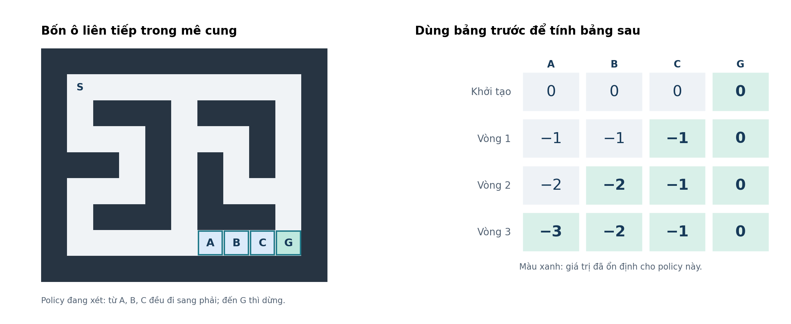
</p>


Trong hình, đích G có giá trị 0 vì trò chơi đã kết thúc. Ô ngay cạnh đích có giá trị −1; ô cần hai bước có giá trị $-1+(-1)=-2$. Phần đường còn lại của ô này chính là bài toán đã giải ở ô tiếp theo. Nhờ sử dụng lại những kết quả đó, chúng ta xây dựng được bảng giá trị cho cả mê cung.

Đến đây, chúng ta đã có cơ sở để đánh giá một cách chơi. Để tìm cách chơi tốt nhất, cần thêm bước so sánh và lựa chọn hành động dựa trên các giá trị ấy. Phần tiếp theo về **Bellman** sẽ phát triển mối liên hệ này từ đánh giá một policy sang tìm policy tối ưu.

### Bellman: từ đánh giá đến lựa chọn hành động

Ở phần trước, chúng ta giữ cố định policy để tính giá trị của các trạng thái. Mối liên hệ **giá trị hiện tại bằng reward trước mắt cộng giá trị tương lai đã chiết khấu** chính là *Bellman expectation equation — phương trình Bellman kỳ vọng*. Nó trả lời câu hỏi: nếu tiếp tục chơi theo policy này, kết quả sẽ như thế nào?

Bây giờ, chúng ta muốn tìm **cách chơi tốt nhất**. Thay vì lấy trung bình theo những hành động mà policy hiện tại lựa chọn, ta so sánh các hành động và giữ kết quả cao nhất. Gọi $V^*(s)=\max_\pi V^\pi(s)$ là giá trị tối ưu, ta có *Bellman optimality equation — phương trình Bellman tối ưu*:

$$
V^*(s) = \max_a
\\
\mathbb{E}\left[
\\
r_t+\gamma V^*(s_{t+1})
\\
\mid s_t=s,\ a_t=a
\\
\right].
\\
$$

Công thức này tách bài toán thành **chọn một hành động hiện tại, rồi tiếp tục tối ưu từ trạng thái mới**. Kỳ vọng ở đây tính đến những kết quả mà môi trường có thể tạo ra sau hành động đó. Với mê cung, mỗi hành động dẫn đến đúng một trạng thái, nên phép tính trở thành:

$$
\max_a\left[
\\
r(s,a)+\gamma V^*(f(s,a))
\\
\right].
\\
$$

Ở đây, $r(s,a)$ là reward nhận được khi thực hiện hành động $a$ tại trạng thái $s$, $f(s,a)$ là trạng thái tiếp theo, còn $V^*(f(s,a))$ là giá trị tối ưu từ trạng thái đó.

<p align="center">
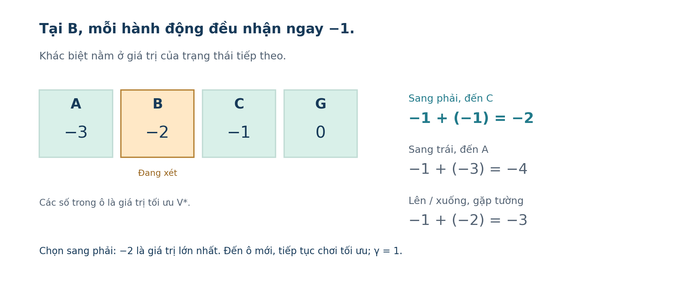
</p>


Hãy đọc hình từ vị trí B. Đi sang phải nhận −1 và đến C, nơi có giá trị −1, nên tổng là −2. Đi sang trái cũng nhận −1 nhưng đến A, nơi có giá trị −3, nên tổng là −4. Nếu đi lên hoặc xuống, tác nhân gặp tường và vẫn ở B: mất một bước rồi còn phần đường trị giá −2, tổng là −3. Vì −2 lớn nhất, chúng ta chọn sang phải.

Điểm quan trọng là **chọn kết quả tốt nhất sau khi đã tính đến tương lai**, chứ không chỉ chọn reward lớn nhất ở bước hiện tại.

#### Tính giá trị và tìm policy

Hình trên sử dụng bảng giá trị đã tính xong. Để tạo ra bảng đó, chúng ta bắt đầu với các giá trị bằng 0, rồi lặp lại phép tính Bellman tại từng ô. Mỗi vòng xét cả bốn hành động, dùng giá trị ô tiếp theo từ bảng trước và giữ kết quả lớn nhất. Đây là **value iteration.**

```python
V = np.zeros(len(maze["coords"]))
gamma = 1.0

for _ in range(1000):
    previous = V.copy()
    # Reward hiện tại + giá trị ô tiếp theo từ bảng trước.
    candidates = (maze["reward"] + gamma * previous[maze["next_state"]])
    # Giữ kết quả tốt nhất tại mỗi ô.
    V = candidates.max(axis=1)
    V[maze["goal"]] = 0

    if np.max(np.abs(V - previous)) < 1e-10:
        break
    else:
        raise RuntimeError("Bảng giá trị chưa hội tụ.")
# Chọn hành động tốt nhất từ bảng giá trị đã hội tụ.
policy = (maze["reward"] + gamma * V[maze["next_state"]]).argmax(axis=1)
```

`candidates` có một hàng cho mỗi trạng thái và bốn cột tương ứng với bốn hướng đi. `max(axis=1)` lấy **giá trị lớn nhất** trên từng hàng để cập nhật bảng. Khi bảng đã hội tụ, `argmax(axis=1)` lấy **vị trí của hành động đạt giá trị lớn nhất** để tạo policy.

Kết quả của quá trình cập nhật trông như sau:

<p align="center">
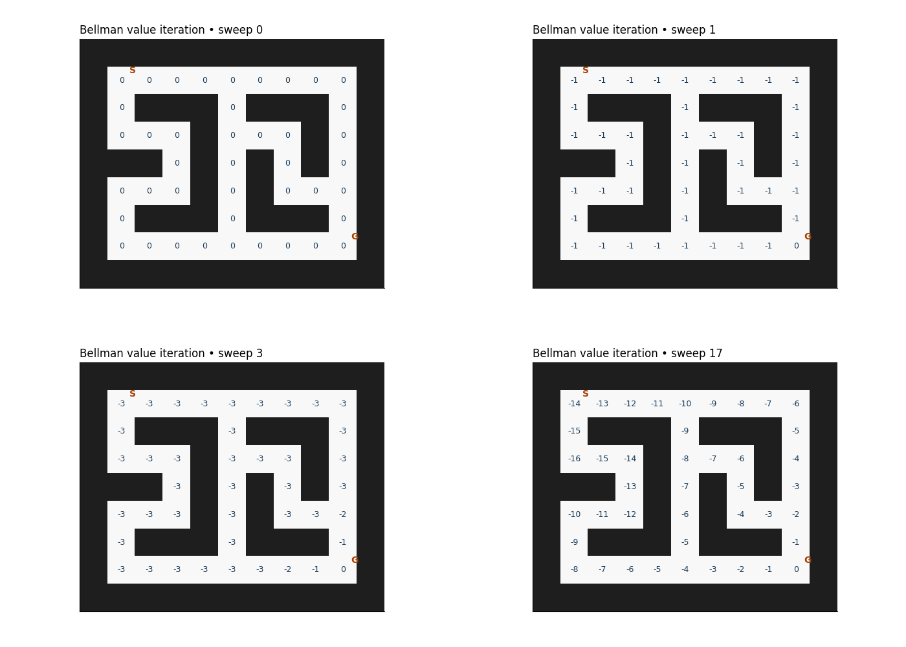
</p>


*Bảng giá trị tại thời điểm khởi tạo, sau vòng 1, vòng 3 và khi hội tụ ở vòng 17.*

Ban đầu, mọi ô đều có giá trị 0. Sau vòng đầu tiên, các ô ngoài đích nhận giá trị −1. Qua những vòng tiếp theo, các ô gần đích ổn định trước, còn các ô xa hơn tiếp tục được cập nhật khi tính đến phần đường còn lại. Khi hội tụ, giá trị tại mỗi ô bằng số bước ngắn nhất đến G, mang dấu âm. Đây là các vòng tính toán trên toàn bộ bảng giá trị, không phải số bước tác nhân đã di chuyển. Và cuối cùng, từ bảng này, chúng ta có thể chọn hành động tốt nhất tại từng ô để tạo thành policy. 

## Quantiatively playing Block Blast!

### Môi trường trò chơi và mô hình MDP

Cuối cùng, chúng ta quay lại Block Blast. Bài toán vẫn là lựa chọn hành động để đạt tổng phần thưởng cao nhất, nhưng giờ mỗi quyết định là **chọn khối nào và đặt vào đâu**. Trong phiên bản này, bàn chơi có kích thước **8×8**. Người chơi nhận ba khối và lần lượt đặt chúng vào những vị trí còn trống. Khi một hàng hoặc cột được lấp đầy, nó sẽ được xóa; những ô khác giữ nguyên vị trí. Dùng hết ba khối thì nhận bộ mới. Trò chơi kết thúc (Game over) khi không thể đặt bất kỳ khối nào còn lại.

<p align="center">

</p>


Các ô được sử dụng
<p align="center">
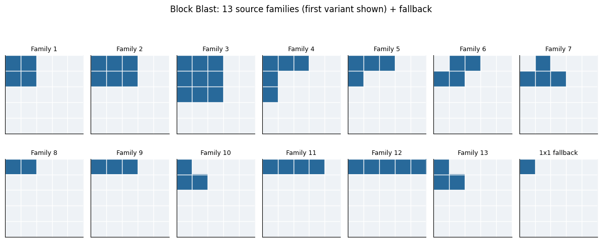
</p>


Để giữ bài toán đơn giản, chúng ta có cá giả định sau: không cho phép xoay khối và chỉ tính reward bằng **số hàng cộng số cột được xóa**. Không có điểm thưởng combo hay phần thưởng riêng cho việc giữ bàn chơi đẹp. Nếu một nước đi chưa xóa được gì, reward của nó bằng 0.

Tương tự mê cung, môi trường này được mô tả bằng MDP:

| **Thành phần**                     | **Trong Block Blast**                                                                  |
| ---------------------------------- | -------------------------------------------------------------------------------------- |
| **State — Trạng thái**             | Những ô đã chiếm trên bàn và các khối chưa sử dụng                                     |
| **Action — Hành động**             | Chọn một khối, hàng và cột để đặt hợp lệ                                               |
| **Transition — Chuyển trạng thái** | Đặt khối, xóa đồng thời các hàng/cột đầy, bỏ khối đã dùng; phát bộ mới nếu đã dùng hết |
| **Reward — Phần thưởng**           | Tổng số hàng và cột được xóa sau hành động                                             |

Có thể viết trạng thái và hành động gọn lại thành:

$$
s=(B,H),\qquad a=(i,r,c),
\\
$$

trong đó $B$ là bàn chơi, $H$ là các khối còn lại, $i$ là vị trí của khối trong bộ đang giữ, còn $(r,c)$ là tọa độ góc trên bên trái của khối khi đặt.

Chỉ bàn chơi thôi chưa đủ để mô tả trạng thái: cùng một bàn, nhưng có khối vuông lớn hay thanh nhỏ sẽ tạo ra những lựa chọn khác nhau. Khi biết cả $B$ và $H$, chúng ta xác định được các nước đi hợp lệ và kết quả của từng nước. Trong phiên bản này, việc phát bộ khối mới phụ thuộc vào bàn hiện tại, nên cũng không cần giữ lại toàn bộ lịch sử chơi (Markov!). Trong phạm vi các khối đang nhìn thấy, chuyển trạng thái là deterministic (tất định): đặt thử một khối ở đâu thì biết chính xác bàn tiếp theo và reward. Đây là điều kiện thuận lợi để áp dụng Bellman. Chúng ta có thể tính trước các cách đặt, đánh giá phần thưởng của cả chuỗi, rồi chọn nước đi đầu tiên.

### Mô hình toán học: đánh giá một chuỗi đặt khối

Từ trạng thái $s=(B,H)$, gồm bàn chơi $B$ và các khối chưa dùng $H$, chúng ta muốn tìm cách đặt để đạt tổng phần thưởng cao nhất. Gọi $A(s)$ là tập các hành động hợp lệ; mỗi hành động $a=(i,r,c)$ chọn khối $i$ và vị trí đặt $(r,c)$. Phạm vi tính toán giới hạn trong **những khối đang nhìn thấy**, tối đa ba lần đặt.

#### Reward: đánh giá kết quả của một nước đi

Mục tiêu là xóa nhiều hàng và cột, nên reward sau một hành động được định nghĩa là:

$$
r(s,a)=N_{\text{hàng được xóa}}+N_{\text{cột được xóa}}.
\\
$$

Các hàng và cột đầy được xác định đồng thời trước khi xóa. Không xóa được gì thì nhận 0; xóa một hàng nhận 1; xóa đồng thời một hàng và một cột nhận 2. Không có reward riêng cho việc đặt khối hay hình phạt khi thua. Những hành động không hợp lệ bị loại khỏi $A(s)$. Ngoài ra, Reward đánh giá **một nước đi**, còn hàm giá trị đánh giá **cả phần tiếp diễn**. Vì vậy, nước đi nhận 0 vẫn có thể tốt nếu nó chuẩn bị cho những lần xóa sau.

#### Value function và Bellman

Chúng ta đang có ba khối để đặt. Một cách chơi đơn giản là chọn nước xóa được nhiều line nhất ngay lập tức. Nhưng nếu nước đó chiếm mất chỗ của hai khối còn lại thì sao? Thay vì đánh giá riêng nước đầu tiên, chúng ta sẽ **tính phần thưởng của cả chuỗi đặt khối rồi mới quyết định** (đây là cách của người viết chơi :)).

Gọi $V_d(s)$ là tổng reward tốt nhất có thể đạt được từ trạng thái $s$ khi nhìn trước tối đa $d$ lần đặt, trong bộ khối đang giữ. Như vậy, $V_1(s)$ chỉ xét một lần đặt, còn $V_3(s)$ xét tối đa ba lần đặt. Áp dụng Bellman:

$$
V_d(s)=\max_{a\in A(s)}
\\
\left[r(s,a)+\gamma V_{d-1}(f(s,a))\right].
\\
$$

Để đánh giá một nước đi, chúng ta cộng **reward nhận ngay** với **kết quả tốt nhất của những lần đặt còn lại**. Sau mỗi lần đặt, số bước cần xét giảm đi một. Khi hết bước, hết khối hoặc không thể đặt tiếp, phần giá trị còn lại bằng 0.

Trong thử nghiệm, chúng ta dùng $\gamma=1$ để cộng trực tiếp số line được xóa. Chẳng hạn, một nước đi xóa ngay 1 line nhưng chỉ tạo điều kiện xóa thêm 1 line sẽ có tổng giá trị là 2. Một nước khác chưa xóa gì nhưng giúp hai khối còn lại xóa 3 line sẽ có tổng giá trị là 3. Thuật toán sẽ chọn nước đi thứ hai, dù chưa ghi điểm ngay nhưng tối ưu được lợi ích trong dài hạn.

Chúng ta tính các kết quả này bằng cách thử những cách đặt hợp lệ trên bản sao của bàn chơi. **Dynamic Programming** giúp lưu và dùng lại kết quả khi gặp cùng bàn chơi, cùng các khối còn lại và cùng số bước cần xét. Phần tính toán có thể viết gọn như sau:

```python
def choose_action(board, hand, depth=3, gamma=1.0):
    if depth not in (1, 2, 3):
        raise ValueError("depth phải là 1, 2 hoặc 3.")

    cache = {}

    def value(board, hand, steps):
        if steps == 0 or all(piece < 0 for piece in hand):
            return 0.0

        key = (board.tobytes(), tuple(hand), steps)
        if key not in cache:
            moves = enumerate_placements(board, hand)
            cache[key] = max(
                (
                    move["lines"]
                    + gamma * value(
                        move["board"], move["hand"], steps - 1
                    )
                    for move in moves
                ),
                default=0.0,
            )
        return cache[key]

    moves = enumerate_placements(board, hand)
    if not moves:
        return None

    best_move = max(
        moves,
        key=lambda move: (
            move["lines"]
            + gamma * value(
                move["board"], move["hand"], depth - 1
            )
        ),
    )
    return best_move["action"]
```

Sau khi so sánh, thuật toán sẽ thực hiện **nước đi đầu tiên** có tổng giá trị cao nhất, quan sát bàn mới rồi tính lại. Khi dùng hết ba khối, trò chơi phát bộ mới và tiếp tục. Vì chỉ tính trong bộ khối đang thấy, phương pháp này chưa đánh giá được phần thưởng từ những bộ sẽ xuất hiện sau đó.


### Play the game

Phương trình Bellman giúp chúng ta đánh giá mỗi nước đi bằng cả **reward nhận ngay và phần thưởng có thể đạt được về sau**. Để tính phần giá trị tương lai này, thuật toán cần nhìn trước: sau khi đặt một khối, bàn chơi sẽ thay đổi thế nào, các khối còn lại có thể đặt ở đâu và những lựa chọn đó mang lại bao nhiêu reward?

Đây là bước **planning, lập kế hoạch** trong reinforcement learning: dùng mô hình môi trường để xem xét kết quả của các hành động trước khi thực hiện chúng. Với Block Blast, luật đặt khối và xóa hàng/cột đã biết, nên tác nhân có thể mô phỏng chính xác các nước đi trong bộ khối đang giữ.

Chúng ta thực hiện bước planning bằng **tìm kiếm trên cây trạng thái**. Gốc cây là bàn hiện tại cùng những khối chưa dùng. Mỗi nhánh tương ứng với việc chọn một khối và đặt vào một vị trí hợp lệ. Tác nhân mô phỏng hành động đó, cập nhật bàn rồi tiếp tục xét các cách đặt khối còn lại. Cây mở rộng tối đa ba lần đặt, hoặc dừng sớm nếu không còn nước hợp lệ.

<p align="center">
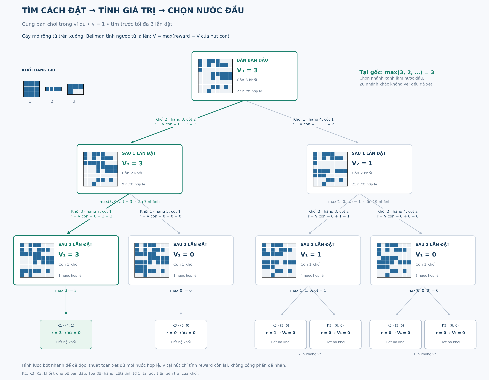
</p>


*Bàn ban đầu có 22 hành động hợp lệ. Hình chỉ mở rộng một số nhánh để minh họa; thuật toán vẫn xét đầy đủ các lựa chọn.*

**Tìm kiếm tạo ra các phương án; Bellman xác định giá trị của chúng.** Sau khi xét phần cuối của mỗi nhánh, thuật toán tính ngược về gốc. Tại mỗi trạng thái, nó giữ lựa chọn có tổng reward hiện tại và giá trị tiếp diễn cao nhất:

$$
V_d(s)=\max_{a\in A(s)}
\\
\left[r(s,a)+\gamma V_{d-1}(f(s,a))\right].
\\
$$

Trong đó, (d) là số lần đặt tối đa còn xét. Khi hết bước, hết khối hoặc không thể đặt tiếp, giá trị tiếp diễn bằng 0. DP lưu kết quả theo bàn chơi, các khối còn lại và số bước cần xét, giúp tránh tính lại những bài toán trùng nhau giữa các nhánh.

<p align="center">
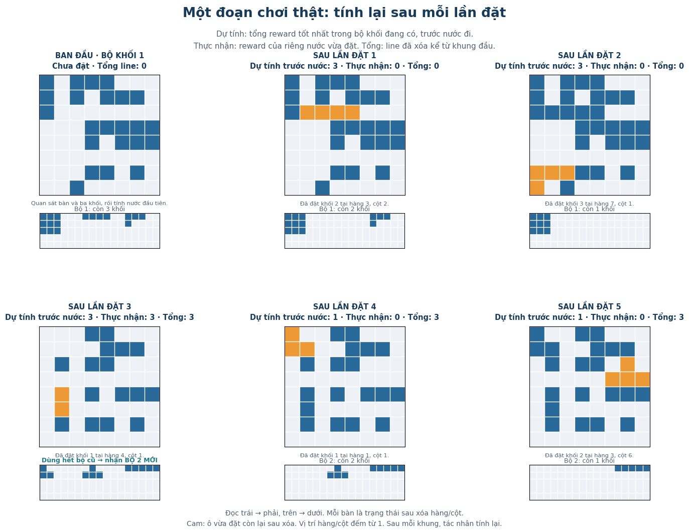
</p>


Xét nhánh xanh trong hình với ($\gamma=1$). Chuỗi đặt thanh ngang, khối chữ L rồi khối vuông nhận reward lần lượt là **0, 0 và 3**. Gọi ($s_1,s_2$) là trạng thái sau hai lần đặt đầu, Bellman tính:

$$
\begin{aligned}
\\
V_1(s_2)&=3+0=3,\\
\\
V_2(s_1)&=0+V_1(s_2)=3.
\\
\end{aligned}
\\
$$

Như vậy, nước đặt thanh ngang ở gốc có giá trị (0+3=3). Ở nhánh bên phải, đặt khối vuông nhận ngay 1 điểm, nhưng hai lần đặt còn lại chỉ mang lại thêm tối đa 1 điểm. Hai lựa chọn được so sánh bằng:

$$
\underbrace{0+3}_{\text{thanh ngang trước}}
\\
\underbrace{1+1}_{\text{khối vuông trước}}.
\\
$$

Đây là điểm khác biệt giữa **greedy** và **DP nhìn trước ba bước**. Greedy chỉ so sánh reward ngay lập tức, nên ưu tiên nước xóa được 1 line. DP ba bước tính cả phần tiếp diễn, nên chọn nước chưa ghi điểm nhưng dẫn đến tổng reward cao hơn. Sau khi đánh giá mọi lựa chọn, tác nhân thực hiện một nước có giá trị cao nhất, quan sát bàn mới rồi lập kế hoạch tiếp. Khi dùng hết bộ khối, môi trường phát bộ mới và quá trình lặp lại.

Việc mở rộng tìm kiếm cũng tạo ra một đánh đổi: **nhìn trước nhiều hơn có thể giúp chọn nước tốt hơn, nhưng cần thêm thời gian tính toán**.

<p align="center">
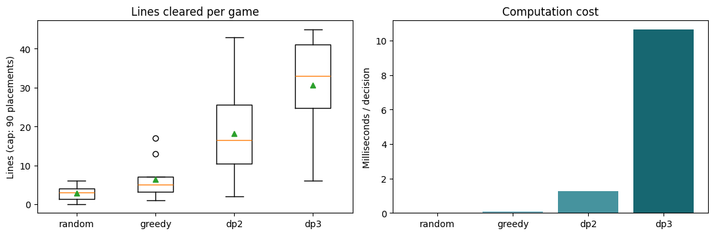
</p>


*Thử nghiệm 10 ván cho mỗi phương pháp, giới hạn 90 lần đặt mỗi ván. Bên trái là số line được xóa; bên phải là thời gian trung bình để chọn một nước.* `_dp2_` *và* `_dp3_` *lần lượt nhìn trước tối đa hai và ba lần đặt.*

Trong lần chạy này, greedy dùng khoảng **0,10 ms/nước**, DP hai bước dùng **1,27 ms**, còn DP ba bước dùng **10,63 ms**. Số line trung bình mỗi ván tăng từ **6,4** với greedy lên **30,6** với DP ba bước. Kết quả cho thấy lợi ích của việc xét phần tiếp diễn trong thử nghiệm này, cùng chi phí tính toán đi kèm. Nó chưa bảo đảm lựa chọn tốt nhất trong bộ hiện tại sẽ tối ưu cho cả ván, vì các bộ khối tương lai chưa được đưa vào tìm kiếm.

Tới đây, ta nhận ra rằng, để chơi Block Blast này, ta có thể sử dụng mô hình RL rất đơn giản mà không cần huấn luyện. Thuật toán sử dụng **planning với trực tiếp lên môi trường**, kết hợp tìm kiếm thông qua ước lượng từ Bellman và DP để ra quyết định.

<p align="center">
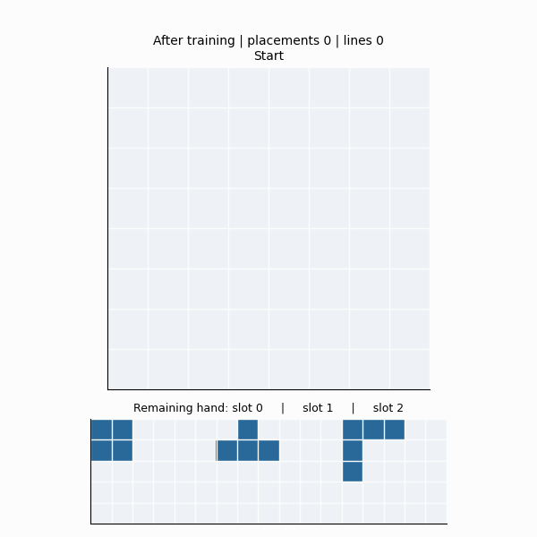
</p>


## Kết luận

Bài viết đầu tiên trong chuỗi bài viết về RL của 51Labs. Bài viết giới thiệu các concept quan trọng của field RL, và thử nghiệm trên trò chơi “Block blast” thông qua việc kết hợp search tree với Bellman & MDP để tự động hoá việc chơi trò chơi này.
Đây là nền móng vững chắc cho việc phát triển thêm các thuật toán RL và ứng dụng của RL ở trong các môi trường và bài toán phức tạp hơn như trading!

Để lấy file code, vui lòng gửi đến mail hung.ha@51labs.vn

